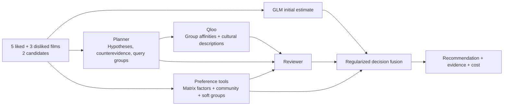

# TasteTrail

**A Qloo-grounded agent that compares films through your tastes, including what you dislike.**

TasteTrail is a working movie preference prototype for the Qloo Agentic Hackathon. Give it five films you liked, three you disliked, and two new candidates. It combines a language model, background preference tools, soft taste groups, and Qloo cultural evidence to recommend one candidate and explain the comparison.

Public demo: **https://tastetrail-qloo-agent.shared-json.chatgpt.site**

Repository: **https://github.com/lkbj0717/tastetrail**

## Why this problem

Two people may enjoy the same crime film for different reasons: intricate characters, atmosphere, social themes, or action. A genre label alone cannot establish their preference. A language model can suggest plausible explanations, but eight ratings do not reveal a person's motives with certainty.

TasteTrail turns that uncertainty into explicit hypotheses, retrieves external cultural evidence, checks contrary observations, and combines the result with numerical preference estimates. This release evaluates **two-candidate movie preference prediction**. It does not establish that a city itinerary or an open-ended recommendation list will satisfy a real traveler.

## How it works



The planner and reviewer are different prompt roles of the same GLM service, not separately trained foundation models. The reviewer does not see the initial GLM choice. Qloo contributes in two places:

1. Cultural relationships smooth preferences within **12- and 24-component soft taste mixtures**. A person can belong to several taste groups with different weights.
2. The reviewer receives the planner's liked/disliked group affinities and genuine film culture descriptions, including available themes, style, and emotional tone.

Qloo affinities describe population-level cultural associations; they are not the probability that a particular person will enjoy a film. Missing evidence stays unknown. See [architecture and prompt locations](docs/ARCHITECTURE.md).

## Results and their limits

The final configuration was frozen before evaluating 100 previously unused target users from MovieLens 1M. Every method saw the same eight history ratings and candidate pair.

| Method | Correct / 100 | Accuracy | Aggregate token ratio |
|---|---:|---:|---:|
| GLM, one API request | 63 | 63% | 1.00× |
| Agent without Qloo | 68 | 68% | 4.70× |
| Agent + Qloo | 70 | 70% | ≤6.06×, conservative accounting |

Qloo improved three cases and worsened one relative to the Agent: **+2 percentage points**, paired bootstrap 95% interval **[−2, +6] points**, exact two-sided McNemar **p = 0.625**. The improvement is promising but **not statistically significant**. The final 70% accuracy has a Wilson 95% interval of **60.4–78.1%**. The 70% target was our project goal, not an official competition threshold.

One Qloo-branch record had incomplete provider usage reporting, so its true aggregate billed token count is unknown. The table uses the registered conservative accounting bound; the largest case-level bound was 12.16× the one-call baseline. Qloo requests and local computation are separate costs. Details, difficulty groups, matched ablation, and limitations are in [EXPERIMENTS.md](docs/EXPERIMENTS.md) and the [machine-readable aggregate report](work/culture_v13/research/confirmation_report.json).

## Quickstart

Run these commands from the repository root on Linux. The validated environment used Python 3.12. Keep `work/culture_v11` and `work/culture_v13` adjacent: the current implementation reuses the earlier API and numerical components.

```bash
uv venv --python 3.12 .venv
uv pip install --python .venv/bin/python -r work/culture_v13/requirements-runtime-lock.txt
export PYTHONPATH="$PWD/work/culture_v13:$PWD/work/culture_v11:$PWD/work/culture_v11/src"
export OPENBLAS_NUM_THREADS=2
```

The source repository intentionally excludes credentials, original user ratings, model assets derived from those ratings, and raw Qloo responses. **A fresh clone needs private runtime assets before recommendations can run.** No GPU is required.

### Server credentials

Set the following server environment variables, or put the same keys in the private JSON file `~/.config/tastetrail/credentials.json` with file mode `600`. `TASTETRAIL_CREDENTIALS` may point to another private JSON file. Do not place that file inside the repository.

| Variable | Value |
|---|---|
| `QLOO_API_KEY` | Your Qloo hackathon API key |
| `TASTETRAIL_MODEL_PROVIDER` | `glm` |
| `GLM_API_KEY` | Your authorized model-service API key |
| `GLM_BASE_URL` | Your compatible chat-completions base URL |
| `GLM_MODEL` | Model name supported by that service |

The recorded experiments used `glm-5.3-flash` through an authorized third-party endpoint. That alias is not an independently verified model-weight version. Changing the model or provider requires fresh validation. Qloo requests use `https://hackathon.api.qloo.com`.

### Build or check runtime assets

If you already have the private assets, check them without API calls:

```bash
.venv/bin/python work/culture_v13/bootstrap_runtime.py --check --with-graph
```

For a **new server**, first read the [MovieLens dataset terms](https://files.grouplens.org/datasets/movielens/ml-1m-README.txt), then run:

```bash
.venv/bin/python work/culture_v11/download.py
.venv/bin/python work/culture_v11/bootstrap_runtime.py
.venv/bin/python work/culture_v13/bootstrap_runtime.py --build --with-graph --allow-network
.venv/bin/python work/culture_v13/bootstrap_runtime.py --check --with-graph
```

This downloads MovieLens from GroupLens, verifies the fixed 473-film Qloo catalog, builds numerical tools from 3,640 disjoint background users, and retrieves allowed public cultural fields. It needs a working Qloo key; catalog resolution can require roughly 473–946 searches, followed by metadata queries. Runtime building does not call GLM or load confirmation answers. Existing assets are preserved rather than overwritten.

Default private directories are `~/.local/share/tastetrail/culture_v11`, `culture_v13`, and `qloo_cache`. If you customize them, keep the two version directories adjacent and consult the [full runtime guide](work/culture_v13/RUN_GUIDE.txt). Rebuilding with current upstream data enables deployment; it does not reproduce the historical API snapshot or guarantee the reported score.

### Test and start

```bash
.venv/bin/python -m pytest -q work/culture_v13
.venv/bin/python -m uvicorn app_v13:app --host 127.0.0.1 --port 8773
```

Open <http://127.0.0.1:8773>. Load the example, then run the recommendation or compare the three methods. `GET /health`, `/api/catalog`, `/api/example`, and `/api/research` do not trigger paid API calls. `POST /api/recommend` and `/api/compare` do. The ten selected films must be distinct and in the available catalog.

Local startup does not publish the service. See [deployment instructions](docs/DEPLOYMENT.md) for the public demo arrangement.

## Repository map

| Path | Purpose |
|---|---|
| `web/` | Hosted frontend with HTTPS backend access; optional server proxy |
| `deploy/` | Python deployment boundary, runtime checks, and launch script |
| `work/culture_v13/app_v13.py` | FastAPI routes and validated input schema |
| `work/culture_v13/service_v13.py` | Production recommendation orchestration |
| `work/culture_v13/demo_v13.html` | Browser UI |
| `work/culture_v13/hierarchical_agent.py` | Planner, reviewer, exact-candidate Qloo queries |
| `work/culture_v13/hierarchical_repair.py` | Bounded recovery of malformed/truncated reviews |
| `work/culture_v13/mixture_tools.py` | Soft taste-group models |
| `work/culture_v13/feature_tools_v13.py`, `inference_v13.py` | Shared online/evaluation features and decisions |
| `work/culture_v13/agent_config.json` | Frozen selected configuration and fusion weights |
| `work/culture_v13/research/` | Final evaluation aggregates and confirmation provenance |
| `work/culture_v11/src/tastetrail/` | Shared clients, collaborative tools, and fusion code |

The shared source directories retain their internal version names to preserve working imports. The public release contains the final system, its deployment code, tests, and final evaluation evidence. [Release provenance](docs/RELEASE.json) records the selected configuration and its relationship to the original confirmation snapshot.

## Submission and attribution

[Architecture](docs/ARCHITECTURE.md) explains the implemented components and credits the ideas used in this system.

Code is released under [MIT](LICENSE). MovieLens data and Qloo data/services retain their respective terms; the code license does not relicense them. See [data and licensing notes](docs/DATA_AND_LICENSES.md).
